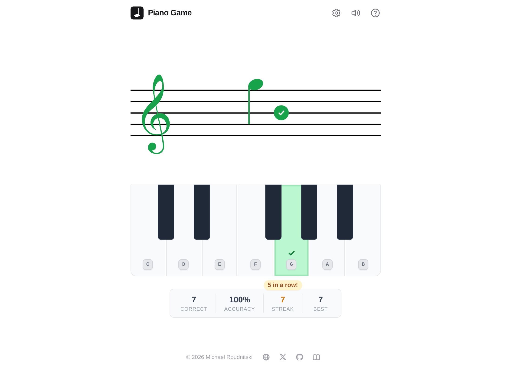

# Piano Game

[](https://github.com/michaelroudnitski/piano-game/actions/workflows/ci.yml)

A quick and fun app I wrote that helped me learn to read musical notes. It shows one note on a music staff at a time, and you name it.

**Play it: [pianogame.mroudnitski.com](https://www.pianogame.mroudnitski.com)**



## How to play

A note appears on the staff. Name it by typing its letter (`C` through `B`) or by tapping that key on the on-screen piano.

- A right answer plays the note and moves on. A wrong key is marked with a ✗; after two misses the game shows you the answer, and you press it to continue.
- The scoreboard keeps your accuracy, streak and best streak.
- ⚙ picks what to practice: treble, bass or both clefs, with notes on the staff only or out to one or two ledger lines. Notes you miss come up a little more often.
- `M` mutes the sound and `?` shows the instructions again.

## Development

Next.js (pages router), React and Tailwind CSS, in plain JavaScript. There is no backend and there are no accounts.

Bun and Node versions are pinned in [`.tool-versions`](.tool-versions). [mise](https://mise.jdx.dev) installs both:

```bash
mise install
bun install
bun run dev    # http://localhost:3000
```

If mise isn't activated in your shell, prefix commands with `mise exec --`, for example `mise exec -- bun run dev`. Without mise, install Bun 1.x and Node 24 yourself.

| Script | What it does |
| --- | --- |
| `bun run dev` | Start the dev server |
| `bun run build` | Create the production build |
| `bun run start` | Serve the production build |
| `bun run lint` | Lint with ESLint (`eslint.config.mjs`, Next.js `core-web-vitals` preset) |
| `bun run test` | Run the unit tests (`*.test.js`) with Bun's built-in test runner |

GitHub Actions runs install, lint, test and build on every pull request and every push to `main`.

If a build warns that `caniuse-lite` is outdated, `bun update caniuse-lite` refreshes it (lockfile only).

## Project structure

```text
pages/        index.js wires the game together; _document.js sets up the HTML shell
components/   UI: the staff, the piano, the scoreboard, the header and help card, practice settings
lib/          Game logic, with tests beside it: staff geometry, the answer loop, the note deck
              and adaptive practice, and a small Web Audio piano
styles/       globals.css: Tailwind layers, layout scaling and animations
public/       App icons, web manifest and social preview image
docs/         README screenshot
```

## Deployment

The live site runs on Vercel. The repo has no Vercel-specific configuration: the app is a static Next.js build with no API routes or environment variables, so importing it into Vercel with the default Next.js settings is enough. Any host that runs Next.js works too. To try the production build locally, run `bun run build` and then `bun run start`.

## License

[Apache 2.0](LICENSE)
